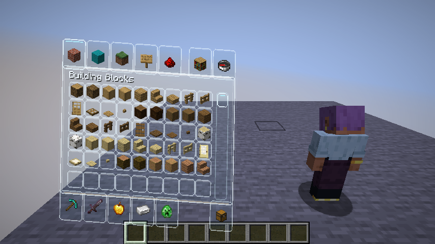
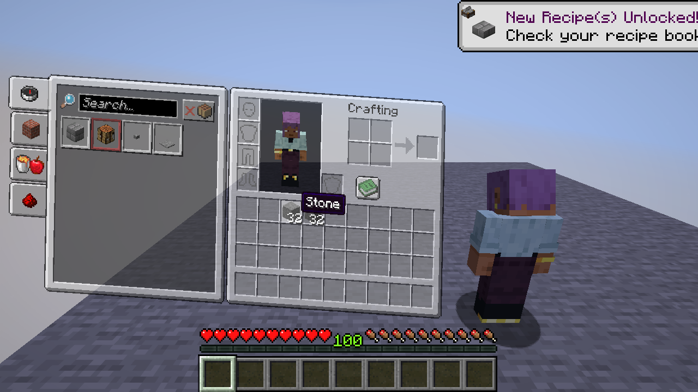

# Hoverglass

**26.x · 0.56.0 snapshot time in the tooltip:** Hovering **Restore newest snapshot** now also says when that snapshot was taken, in the same local time the file manager shows, so restoring is an informed choice instead of grabbing the latest copy blindly. The timestamp is read from the snapshot's file name, a missing or unreadable history shows only the usual hint, and the count and the time always describe the same file.

**26.x · 0.55.0 page resets cover every control:** Resetting the transparency page now also turns the **Liquid glass UI** theme back off, and resetting the screen support page turns the master effects switch back on — both sat on those pages but were left untouched by Delete and **↺**. Every page now restores exactly the controls it shows.

**26.x · 0.54.0 master effects switch:** The screen support page now exposes **Hoverglass effects**, the config's master switch that previously required editing the file. Turned off, the glass panels, hotbar glass, menu theme and added avatar animations stop without clearing a single setting, and the configured settings key keeps working so the switch is always reachable to turn everything back on.

**26.x · 0.53.0 accurate hints on the compatibility page:** The footer no longer promises that Delete resets the page while the compatibility page is open, and the disabled **↺** button now explains why: that page holds hand-written exclusions and per-screen rules, so it is reset in the config file. Every other page keeps the full hint and the working reset button.

**26.x · 0.52.0 confirm the restores:** **Restore previous settings** and **Restore newest snapshot** now take two clicks as well. The first press changes the label to **Click again to confirm**; the second replaces the config. Both share the confirmation used by the full reset, which is thrown away whenever the page rebuilds — so changing pages or pressing another action never leaves a restore waiting to fire. A missing backup or snapshot still reports itself and returns to the unarmed state.

**26.x · 0.51.0 confirm the full reset:** **Reset all settings** on the transparency page now takes two clicks. The first arms it and changes the label to **Click again to reset all**; the second restores every page and container override. Navigating away, resizing, or pressing any other action button disarms it, so the confirmation cannot linger, and the rotating snapshots remain the way back if the reset was a mistake.

**26.x · 0.50.0 full duration range:** The **Camera transition** and **GUI animation duration** sliders now cover the whole 0–2000 ms range the config already accepted. Previously they stopped at 1000 ms, so a hand-edited value above that pinned the knob at the right edge and snapped back on the first drag; slowly sweeping transitions can now be set from the UI, and the readout follows the new range.

**26.x · 0.49.0 level the camera:** The camera angles page gains **Level the camera**, which zeroes both angle offsets in one click while keeping the pull-back distance, sideways framing, panel tilt and transition duration exactly as they are — handy after trying angles without wanting to snap back to a whole framing preset. It greys out once both offsets are zero and re-enables as soon as either slider moves, and Delete on the page still restores every camera value.

**26.x · 0.48.0 trackpad scrolling:** The settings pages can now be changed with a trackpad or a fine-grained wheel. Previously every scroll event had to carry at least half a notch by itself, so devices reporting many small deltas never flipped a page; the screen now keeps a running total and moves once the deltas add up, while a normal wheel notch still turns exactly one page. Opposite-direction jitter cancels out instead of adding up, a fast flick is capped at one page, and partial scroll is dropped whenever the page changes by any other means.

**26.x · 0.47.0 match the panel fill:** The hotbar page gains **Match panel opacity**, the companion to **Match inventory rim**. It copies the glass panel's current fill opacity onto the hotbar's independent value in one click, so a HUD that should read as part of the same surface can be aligned without dragging two sliders. Like the rim match it is a one-off copy, the panel's own value is untouched, the hotbar rim stays as it was, and either slider can still be tuned afterwards.

**26.x · 0.46.0 opening brake slider:** The panel feel page now exposes **Opening brake**, the deceleration applied while the panel slides in — previously reachable only by hand-editing `slideBrake`. Higher values stop the panel sooner after the initial push; lower values let it coast toward its resting spot before the settle spring takes over. The readout is in px/s², the page's Delete reset restores the stock 3450, and the remaining feel sliders shift down one row to make space.

**26.x · 0.45.0 sliders show real units:** The panel feel and preview layout pages no longer report raw slider positions. Opening and closing speed now read in px/s, bounce as a percentage, settle stiffness and damping as their plain strengths, preview placement as percentages of the screen, and the recipe book offset in pixels — matching what each tooltip already promised. Out-of-range values still clamp, invalid values still fall back safely, every other slider's readout is unchanged, and the formatting lives in a small pure-Java helper the tests walk key by key.

**26.x · 0.44.0 reset-page button:** A **↺** button beside the page arrows resets the open page to its factory values, so the per-page reset no longer depends on knowing the Delete shortcut. It calls the same `PageDefaults` mapping as the key, greys itself out on the compatibility page where a reset would discard hand-written rules, and the footer hint still names Delete for keyboard users.

**26.x · 0.43.0 camera framing presets:** The camera angles page gains **Subtle**, **Balanced** and **Cinematic** buttons that set the whole framing in one click — pull-back distance, sideways offset, panel tilt, both angle offsets and the transition duration move together, so the settled view and the sweep into it stay matched. **Balanced** is exactly the stock config and doubles as a restore; the button matching the current framing is disabled, and Delete on the page now restores all six values rather than just the two angles.

**26.x · 0.42.0 match the hotbar rim:** The hotbar page gains **Match inventory rim**, which copies the glass panel's current rim strength onto the hotbar's independent value in one click. It is a one-off copy rather than a live link, so either slider can still be tuned afterwards, and the hotbar keeps its own rim until the button is used again.

**26.x · 0.41.0 snapshot count on the restore button:** **Restore newest snapshot** now shows how many snapshots are kept next to its label, and greys itself out with an explanatory tooltip when the history is empty. The count refreshes every time the page is rebuilt, so restoring or saving is reflected immediately, and a failed read is treated as zero rather than a guess.

**26.x · 0.40.0 retired config keys removed:** Four values that no longer drove anything — `lookDistance`, `maxBodyYaw`, `bodyYawRatio` and `playerSlideSmoothing` — are gone from the saved file, so the config no longer advertises knobs that silently do nothing. Existing files that still name them keep loading: unknown keys are ignored, the remaining values are read normally, and the next save drops the stale entries.

**26.x · 0.39.0 remembered page survives restarts:** The page memory from 0.32.0 is now saved as `settingsPage` in the config, so closing the game and reopening it returns to the same settings page instead of starting over at transparency. Navigating still updates the session immediately, an out-of-range hand-edited value clamps back to the first page, and leaving the settings screen performs the save as before.

**26.x · 0.38.0 clear added screens:** The screen support page gains **Clear added screens**, which removes every screen previously opted in through the page — exact entries and wildcard rules alike — in one click. Hand-edited opt-ins in `additionalScreens` are cleared too, matching the existing clear buttons on the compatibility page, and the built-in container handling is untouched. The button sits below the settings-key control and refreshes the page immediately.

**26.x · 0.37.0 restore newest snapshot:** The rotating history from 0.31.0 can now be used without opening a file manager. **Restore newest snapshot** on the compatibility page loads the latest timestamped copy in `transparent_inventory-backups/` and saves it, covering the case where several bad saves have already pushed the plain `.bak` out of reach. With no snapshot yet the button says so instead of failing silently, unrelated files in the folder are ignored, and copy/paste now share one row to make space.

**26.x · 0.36.0 panel feel page:** A fifteenth page exposes the slide itself. **Opening slide speed**, **Closing slide speed**, **Bounce**, **Settle stiffness** and **Settle damping** tune how the glass panel enters, springs back and settles — from a brisk clean stop to a slower, softer drift. These are the exact values the animator already used, so the page changes the real panel, and Delete restores the stock feel. Reduced motion still snaps everything instantly regardless of the sliders.

**26.x · 0.35.0 preview layout page:** A fourteenth page exposes five placement values that previously required hand-editing the config. **Preview height**, **Preview horizontal position** and **Preview vertical position** place the third-person avatar on screen, while **Panel horizontal position** moves the glass panel and **Recipe book offset** shifts it when the recipe book is open. The avatar overlaps the panel on some resolutions and GUI scales; the sliders fix that without JSON. Each value keeps its sanitizer range, Delete on the page restores all five, and the avatar is still a pose-only preview.

**26.x · 0.34.0 scroll to change pages:** The mouse wheel now moves through the F8 pages — scrolling up goes back, scrolling down goes forward, both wrapping at the ends. Reaching the last page no longer takes nine clicks or a trip to the keyboard. Sub-notch trackpad jitter and invalid scroll amounts are ignored so a page cannot flip by accident, and Page Up / Page Down still work as before.

**26.x · 0.33.0 dim fades with the panel:** The world dim behind the glass panel now follows the entrance instead of appearing at full strength on the first frame. Opening darkens the world as the panel slides in, and closing lifts the dim with the panel, so neither transition jumps. The **World dim** strength still sets the settled opacity, reduced motion and zero-length durations still snap instantly, and screens that do not use the spatial panel keep their vanilla dim.

**26.x · 0.32.0 remembered settings page:** The F8 screen now reopens on the page last viewed in this session instead of always starting at transparency, so repeated tweaks to the same page take one key press. **End** jumps straight to the last page, matching **Home** for the first; both use the same clamped page memory and the page counter keeps its position after every rebuild.

**26.x · 0.31.0 rotating config snapshots:** Save-time protection no longer stops at a single `.bak`. Every save also writes a timestamped copy into `config/transparent_inventory-backups/` and prunes that folder to the five newest, so several bad saves in a row can still be walked back by hand. The sibling `.bak`, the compatibility page's **Restore previous settings** behaviour and the "a failed copy never blocks the save" rule are unchanged, and the shared loader means both branches get the history.

**26.x · 0.30.0 idle sway:** A standing avatar no longer freezes between actions. A new **Idle sway** switch on the avatar motion page adds a breathing layer — the chest rises, the arms drift outward, and the weight shifts slowly side to side — with amplitudes under three hundredths of a radian and scaling with **Avatar motion intensity**. It stops the moment the walk cycle or a landing takes over and leaves the legs entirely to vanilla; the switch beside it is now labelled **Airborne poses** to make room.

**26.x · 0.29.0 rebindable settings key:** The screen support page now offers **Settings key**, which cycles the shortcut that opens these settings through F6–F10 (F8 stays the default). A conflict with another mod no longer leaves F8 as the only option. The stored `settingsKey` is validated on load and falls back to F8 if a hand-edited config names a gameplay key or anything else outside that set, and the footer hint no longer hard-codes the key.

**26.x · 0.28.0 screen support page:** A thirteenth page exposes three screen-selection values that previously needed a hand-edited config. **Glass for recognized containers** (on by default) decides whether the built-in container screens get the spatial panel at all; **Keep glass when projection fails** decides whether a screen the camera cannot reach falls back to glass or to vanilla. The third button opts the screen the settings were opened from in or out of the panel, so a modded menu no longer requires editing `additionalScreens` by hand — an exact entry is added or removed, wildcard rules are reported but never rewritten, and a real open container explains why the button is disabled.

**26.x · 0.27.0 closing animation switch:** The entrance page now exposes **Closing animation**, a switch that already existed as `closeAnimation` in the config file. Turned off, closing a container removes the glass panel in the same frame instead of sliding it away — handy when swapping containers quickly or when a hard cut is preferred. It shares the top row with **First-person side entrance**, and the page's Delete reset restores it.

**26.x · 0.26.0 per-page reset:** **Delete** restores every control on the open settings page to its factory value without touching the other pages, so one mistuned slider no longer forces the all-or-nothing reset on the transparency page. The mapping lives in a small pure-Java helper the tests walk page by page, and the compatibility page is deliberately excluded because it holds hand-written exclusions and per-screen rules. The footer hint now names the key.

**26.x · 0.25.0 landing pose:** Third-person avatars now absorb a real fall instead of snapping straight back to the walk cycle. The animation layer samples downward speed while the avatar is airborne and, on touchdown, eases a small crouch — knees forward, torso folded, arms out for balance — out over six ticks, scaled by the measured impact and **Avatar motion intensity**. Small drops and step-downs stay vanilla, the **Landing response** switch (previously camera-only) disables the pose along with the camera bump, and attacks, climbing and the airborne pose still take priority.

**26.x · 0.24.0 material presets:** The glass material page gains three preset buttons — **Clear**, **Frosted** and **Vivid** — that set all five alphas in one click. Each bundle stays inside the authored ranges and stays ordered, so fills, rims and highlights thicken together from Clear to Vivid; **Frosted** is exactly the default config, so it doubles as a one-click restore of the stock look. The button for the preset currently in effect is disabled, so the page always shows which material is active, and moving any slider re-enables all three for hand tuning.

**26.x · 0.23.0 glass material page:** A twelfth page exposes the alpha values that previously needed a hand-edited config: **slot fill**, **panel rim**, **slot rim**, **hover highlight** and **selected highlight** opacity. They are the same values the renderer already used, so tuning them changes the actual glass rather than a preview, and everything still clamps to 0–100% on load. The hotbar keeps its own rim control from 0.17.0.

**26.x · 0.22.0 keyboard page navigation:** **Page Up** and **Page Down** cycle the eleven settings pages and **Home** jumps back to the transparency page, so reaching a distant page no longer means clicking through the cycle. The keys use the same wrap-around helpers as the arrow buttons, and the footer hint now names them along with the F8 / Esc save shortcut.

**26.x · 0.21.0 camera angles:** An eleventh settings page, **Camera angles**, exposes two framing offsets that already existed in the config: **Camera side angle** (−60° to +60°) and **Camera height angle** (−45° to +45°). They rotate the settled framing sideways and vertically and blend in with the camera transition like the other camera values. The page keeps compatibility at index 9, so existing pages and the page cycle stay where they were. Both values clamp on load, so a hand-edited config cannot exceed the authored range.

**26.x · 0.20.0 named page headers:** The settings header now says which page is open — "Fluid animations", "Compatibility" and so on. Previously it always described the container's transparency source, even while looking at camera or motion pages; that description is now limited to the transparency page. A new regression check loads both language files and fails the build when `en_us` and `zh_cn` disagree on a key or a settings page title is untranslated, so a missing translation can no longer ship as a raw key.

**26.x · 0.19.0 climb pose:** The **Jump, fall and climb poses** switch now also covers ladders and vines. While an avatar moves vertically on a climbable block, the pose alternates a diagonal reach — right arm with left leg, then the opposite — instead of the walking cycle vanilla leaves running. The reach scales with actual climbing speed and with **Avatar motion intensity**, and reverses while descending; hanging still adds nothing. Nearby players get the same pose because vertical motion is replicated, and attacks still take priority.

**26.x · 0.18.0 quick reopen window:** The entrance page now exposes the **Quick reopen window** slider (0–1500 ms, default 400 ms) that has governed the reopen shortcut since 0.10.0. Dragging it to 0 replays the full entrance on every open; a longer window keeps the shortcut active through slower container-swapping. The slider and the stored `reopenSnapWindowMs` value share one clamped mapping.

**26.x · 0.17.0 hotbar rim:** The hotbar page gains a **Hotbar rim strength** slider, backed by a new `hotbarBorderOpacity` value (default 72%) that is independent of the inventory panel border. Dimming the HUD chrome no longer dulls the inventory rim, and a strong hotbar outline can be kept while the panel stays understated.

**26.x · 0.16.0 head follow speed:** The head-tracking page gains a **Head follow speed** slider (default about 26%, range 0–100%). It drives the existing exponential smoothing, so the preview can glide lazily after the cursor or catch up almost instantly; the update stays frame-rate independent at any FPS. Higher values never overshoot the requested angle.

**26.x · 0.15.0 config backup:** Every save now copies the previous `config/transparent_inventory.json` to `transparent_inventory.json.bak` before writing the new file. The compatibility page gains **Restore previous settings**, which loads that backup and saves it; because the restore is itself a save, pressing it again swaps back to the version you just replaced. With no earlier save yet, the button reports that nothing can be restored instead of failing silently. Only one previous version is kept, and a failed copy never blocks the save itself.

**26.x · 0.14.0 jump and fall pose:** Third-person avatars no longer look like they are running on air. While rising, both knees tuck forward and the arms lift slightly; while falling, the arms spread for balance and the legs trail behind. The layer only runs while the avatar is off the ground and not in water, lava or on a ladder, and a real attack still takes priority. Nearby players get the same pose because vertical motion is server-replicated. It scales with **Avatar motion intensity**, has an independent **Jump and fall pose** switch on the Avatar motion page (on by default), and the master motion or **Reduce motion** switches still disable it.

**26.x · 0.13.0 settings clipboard:** The compatibility page can copy the whole config to the clipboard as pretty JSON and paste it back, so settings can be moved between instances or shared with friends. Pasting validates the text first: anything that is not a JSON object — or is larger than 256 KB — is refused with a chat message instead of replacing the config. Accepted values go through the same sanitizer used at startup, so out-of-range numbers clamp and dirty screen rules are cleaned instead of being written as-is. A successful paste saves `transparent_inventory.json` immediately and rebuilds the page.

**26.x · 0.12.0 page navigation:** The F8 settings screen is now ten pages long, so it gained a **previous** button beside the next button; both wrap around, and each shows a tooltip naming the page it leads to. The footer line now reads **Page 3 / 10** before the live-preview hint, so the position in the cycle is always visible. Page ordering and titles live in a small pure-Java `SettingsPages` helper, which also keeps the next/previous labels and the page cycle in agreement.

**26.x · 0.11.0 compatibility page:** F8 now cycles through a tenth **Compatibility** page. **Exclude this container** turns the glass panel off for the screen that is open, and the same button becomes **Re-include this container**; if the screen is excluded by a wildcard rule instead of its own entry, the button says **Excluded by a screen rule** and leaves the rule untouched so it is never silently rewritten. Two shortcuts below it clear **all exclusions** or reset **all per-screen transparency**, including wildcard entries, and fall back to the global value. Exclusions still live in the same `excludedScreens` list, so hand-written rules and the buttons stay in sync.

**26.x · 0.10.1 screen-rule status:** The F8 transparency header now tells three cases apart: an exact per-screen value, a value inherited from a wildcard screen rule ("Transparency from a screen rule"), and the global value. **Use global for this screen** is enabled only when an exact entry exists and switches itself off once cleared, so a wildcard rule is never mistaken for the global default or silently ignored.

**26.x · 0.10.0 quick reopen:** Closing a container and opening another within 400 ms now skips the panel entrance and the camera transition, snapping straight to the settled view — tapping E on and off no longer replays the full slide every time. The first open and slower reopens animate normally. The window is configurable with `reopenSnapWindowMs` (0 disables the shortcut, up to 1500 ms) and applies to both branches; **Reduce motion** still snaps every open.

**26.x · 0.9.0 container camera:** A new **Container camera** switch on the F8 camera page (on by default) lets chests, furnaces, merchants and other world containers stay in first person while their glass panel, per-screen opacity and world anchoring still apply. The player inventory keeps its own entrance camera, and the master **Spatial camera** switch still overrides both. The choice is saved as `containerCameraEnabled` in the config file, next to the other camera fields.

**26.x · 0.8.1 config recovery:** If `config/transparent_inventory.json` cannot be parsed, the mod now moves it aside as `transparent_inventory.json.corrupt-<UTC timestamp>` before using defaults. Previously the in-memory defaults would replace the unreadable file on the next save, destroying any hand edits worth recovering. Backup names use a Windows-safe UTC timestamp, never collide, and are length-capped; if the move itself fails, the original is left untouched and defaults are used for that session only.

**26.x · 0.8.0 reduced motion:** The existing **Reduce motion** switch now covers the container UI itself. With it on, the glass panel appears and disappears at its resting pose — no slide, overshoot, landing flash or fade — and the camera snaps straight to the container framing instead of sweeping into it. When the switch is off, the F8 durations still apply. A zero-length camera transition now lands on the new view in the same frame instead of one frame later, so dragging the camera-duration slider to 0 also snaps cleanly. Reduced motion is persisted with the rest of the config and applies on both branches.

**26.x · 0.7.0 screen rules:** `screenOpacities`, `excludedScreens` and `additionalScreens` now accept `*` (any run of characters) and `?` (exactly one) wildcards, so a single entry can cover a screen family such as `"net.minecraft.client.gui.screens.inventory.*"` or `"*MerchantScreen"`. An exact class entry always beats a wildcard and the most specific matching pattern wins, so the per-screen slider keeps working unchanged. Rules are trimmed, de-duplicated and length-capped when the config is loaded or saved.

**26.x · 0.6.1 sprint stride:** Sprinting adds a full-body stride on top of vanilla walking — wider alternating legs, a counter-swinging arm pump, forward torso lean and a head counter-rotation. It applies to every visible sprinting player and follows the vanilla walk phase, so ordinary walking is untouched. Toggle it on the F8 **Avatar motion** page.

**26.x · 0.6.0 avatar motion:** Full-body third-person sword, axe, spear and tool swings for every visible player, plus a hands-at-the-bench loop for the local player while a crafting table is open. The pose is added after vanilla animation, so walking, crouching, riding, item use and the vanilla arm swing remain intact; separate armor models receive the same pose so armor follows the body. Workbench motion is local-only because a client-only mod cannot read another player's open menu. Cycle F8 to **Avatar motion** for the master, attack and crafting toggles plus an 80% default intensity. See the [architecture audit and validation boundaries](docs/MOTION-AUDIT.md).

**26.x · 0.5.0 fluid motion MVP:** Time-based held-item lowering/swapping/raising, modest sword/tool swing transforms, subtle sprint/jump/landing camera feedback, confirmed melee-hit response, extra material fragments and a 200 ms placement particle proxy. All effects are client-side; inventory, damage, cooldowns, movement and block rules stay vanilla.

Cycle F8 pages to **Fluid animations → Camera motion → World feedback → Avatar motion** for feature toggles, intensities and reduced motion. Defaults are 65% hand / 50% camera strength. Reduced motion disables the added effects; vanilla view-bobbing, screen-effect and damage-tilt settings are honored. Camera additions suspend in menus, third person, spectator, flight and riding. Vanilla map/use-item hand coordination is preserved. Legacy targets retain their previous feature set.

**26.x · 0.4.1:** The HUD hotbar and offhand well now use the inventory's glass material by default, with a clear selection rim. Item icons, counts, durability and attack indicators retain vanilla rendering. Cycle through F8 pages to **Hotbar settings** for a separate toggle and transparency slider (84% by default).

**26.x · 0.4.0:** Press **F8 → Liquid glass UI** to toggle rounded translucent chrome, edge highlights and mouse reflections on standard menu buttons and sliders, including pause, options and mod settings. Disabled by default; changes apply immediately and persist when leaving settings. The pause backdrop keeps vanilla blur with a cool gradient. This setting is independent of the glass inventory preset. It uses lightweight GUI drawing rather than optical refraction; custom third-party widgets may retain their own appearance. Available on the 26.x branch with F8 settings.

**26.1.2 · 0.3.3:** Chests and other containers default to 135% size, fit the window and no longer shrink with world-anchor distance. The player's rendered head smoothly follows the cursor in survival and creative inventories, including an existing third-person perspective. F8 offers container sizing and a head-tracking page with an enable switch and horizontal/vertical limits. Tracking changes only the extracted model pose; player orientation, camera and server state stay untouched.

<p align="center">
  
  
</p>

**English** | [简体中文](README.zh-CN.md)

> Turns the vanilla container UI into a see-through glass panel that slides in as the camera pulls back.

Hoverglass is a **client-side** Fabric mod. It runs entirely on the client and **does not need to be installed on the server**. It does not replace vanilla screen logic — only the way it is presented: slots, recipe book, trading, item movement and networking all stay vanilla.

A single source tree supports **Minecraft 1.20.1 – 26.3**, split into two implementation branches; the build produces one jar per target version.

| Branch | Versions | Capabilities |
| --- | --- | --- |
| Glass Inventory (legacy) | 1.20.1 – 1.21.11 | Turns the player inventory (`InventoryScreen`) into a glass panel: it slides in from the left with overshoot and rebound, the player preview slides in from the right, and a white flash lands with it. |
| Spatial Container (spatial) | 26.1 – 26.3 | Everything above extended to **all container screens**, plus planar spatial projection, block/entity world anchoring, a first-person ↔ third-person camera transition, full inverse mapping of mouse input, and an in-game **F8** settings screen. |

> On 1.20.1 – 1.21.11 only the player inventory is handled. Chests, barrels, crafting tables, furnaces and every other container are covered from 26.1 onwards — which is also where the in-game settings appear.

## Download

Grab the jar that matches your game version from the [**Releases page**](../../releases); the exact file names are listed in the version table below. Do not use `-sources.jar`, and do not mix jars for different Minecraft versions.

[**→ Download the latest release**](../../releases/latest)

## Installation

1. Install **Fabric Loader 0.19.5 or newer** for your version.
2. Install **Fabric API** (minimum version in the table below).
3. Download the jar matching your game version from the [Releases page](../../releases) and drop it into your instance's `mods` folder. (When building locally the output lands in `dist/`, which is not tracked by git.)
4. Make sure your Java version matches the table: 1.20.1 – 1.20.4 need Java 17, 1.20.5 – 1.21.11 need Java 21, and 26.x needs Java 25.

### Version table

| Minecraft | Jar file | Branch | Java | Fabric API ≥ |
| --- | --- | --- | --- | --- |
| 1.20.1 | `hoverglass-mc1.20.1-0.3.0.jar` | Glass Inventory | 17 | 0.92.12+1.20.1 |
| 1.20.2 | `hoverglass-mc1.20.2-0.3.0.jar` | Glass Inventory | 17 | 0.91.6+1.20.2 |
| 1.20.3 | `hoverglass-mc1.20.3-0.3.0.jar` | Glass Inventory | 17 | 0.91.1+1.20.3 |
| 1.20.4 | `hoverglass-mc1.20.4-0.3.0.jar` | Glass Inventory | 17 | 0.97.3+1.20.4 |
| 1.20.5 | `hoverglass-mc1.20.5-0.3.0.jar` | Glass Inventory | 21 | 0.97.8+1.20.5 |
| 1.20.6 | `hoverglass-mc1.20.6-0.3.0.jar` | Glass Inventory | 21 | 0.100.8+1.20.6 |
| 1.21 | `hoverglass-mc1.21-0.3.0.jar` | Glass Inventory | 21 | 0.102.0+1.21 |
| 1.21.1 | `hoverglass-mc1.21.1-0.3.0.jar` | Glass Inventory | 21 | 0.116.17+1.21.1 |
| 1.21.2 | `hoverglass-mc1.21.2-0.3.0.jar` | Glass Inventory | 21 | 0.106.1+1.21.2 |
| 1.21.3 | `hoverglass-mc1.21.3-0.3.0.jar` | Glass Inventory | 21 | 0.114.1+1.21.3 |
| 1.21.4 | `hoverglass-mc1.21.4-0.3.0.jar` | Glass Inventory | 21 | 0.119.4+1.21.4 |
| 1.21.5 | `hoverglass-mc1.21.5-0.3.0.jar` | Glass Inventory | 21 | 0.128.2+1.21.5 |
| 1.21.6 | `hoverglass-mc1.21.6-0.3.0.jar` | Glass Inventory | 21 | 0.128.2+1.21.6 |
| 1.21.7 | `hoverglass-mc1.21.7-0.3.0.jar` | Glass Inventory | 21 | 0.129.0+1.21.7 |
| 1.21.8 | `hoverglass-mc1.21.8-0.3.0.jar` | Glass Inventory | 21 | 0.136.1+1.21.8 |
| 1.21.9 | `hoverglass-mc1.21.9-0.3.0.jar` | Glass Inventory | 21 | 0.134.1+1.21.9 |
| 1.21.10 | `hoverglass-mc1.21.10-0.3.0.jar` | Glass Inventory | 21 | 0.138.4+1.21.10 |
| 1.21.11 | `hoverglass-mc1.21.11-0.3.0.jar` | Glass Inventory | 21 | 0.141.6+1.21.11 |
| 26.1 | `hoverglass-mc26.1-0.3.0.jar` | Spatial Container | 25 | 0.145.1+26.1 |
| 26.1.1 | `hoverglass-mc26.1.1-0.3.0.jar` | Spatial Container | 25 | 0.145.4+26.1.1 |
| 26.1.2 | `hoverglass-mc26.1.2-0.3.3.jar` | Spatial Container | 25 | 0.155.3+26.1.2 |
| 26.2 | `hoverglass-mc26.2-0.3.0.jar` | Spatial Container | 25 | 0.159.0+26.2 |
| 26.3 | `hoverglass-mc26.3-0.3.0.jar` | Spatial Container | 25 | 0.163.0+26.3 |

## Glass Inventory branch (1.20.1 – 1.21.11)

- Opening the inventory slides the panel in from the left with ~10% overshoot and rebound, the player preview slides in from the right, and a white flash lands with it.
- The glass panel is drawn from scratch: translucent background, edge outline and per-slot borders, all driven by configuration.
- The player preview can be disabled (`playerPreview`); its position and height are controlled by ratio parameters.
- There is no in-game settings screen. Everything is tuned by hand in `config/transparent_inventory.json` and applies after a restart or after reopening the inventory.
- Animation length is controlled by `openingAnimationDurationMs`, currently 480 ms by default in source.

## Spatial Container branch (26.1 – 26.3)

### First-person inventory entrance

Pressing **E** in first person smoothly pulls the camera back and to the left so the real player model appears on the right of the frame; the inventory slides in from the left, overshoots slightly, rebounds, and settles at a default **4°** tilt. On close the panel exits to the left and the camera returns to its original view. The player's actual position and orientation are never modified.

The tilted slots, dragged items, recipe book and player preview all share the same transform, and mouse coordinates are converted through its full inverse matrix. Camera collision is checked behind and beside the player. If you are already in third person, the regular container layout is kept.

### Transparency

Press **F8** to open settings. While a container is open the settings appear as an overlay, and the container is not closed.

- **Global screen opacity** — shared by every screen without its own override, 0–100%. 0% means fully opaque, 100% means a fully transparent background.
- **Current screen opacity** — saved per screen type only. Chests and anvils can use different opacities, for example, while chests of the same type share the setting.
- **Follow global for this screen** — removes that type's individual opacity.
- **World dim strength** — controls how much the world darkens, independently of panel opacity.
- **Spatial and camera settings** — panel scale, camera distance, camera transition duration, and whether the camera and world anchoring are enabled.

Items, counts, durability bars, text, tooltips and slot hover highlights stay readable. The opacity of vanilla panel textures and skin elements does change. **Esc / F8 / Done** saves and returns to the original screen.

The settings screen supports Chinese and English. F8 is a fixed key; Mod Menu and Cloth Config are not required.

## Configuration

Location: `config/transparent_inventory.json` in your game instance, or `run/config/transparent_inventory.json` for the development client.

The in-game slider speaks in "transparency" while the JSON speaks in "opacity": `panelOpacity: 0.65` corresponds to 35% transparency on the slider. A missing file generates defaults, missing fields fall back to defaults, and out-of-range values are clamped to safe limits. A corrupted JSON is renamed to `transparent_inventory.json.corrupt-<UTC timestamp>` and defaults are used, so the next save cannot destroy the unreadable file; if the rename fails the original stays in place and defaults apply to that session. Saving writes a temporary file first and then replaces the original.

Common fields, with an example:

```json
{
  "enabled": true,
  "playerPreview": true,
  "closeAnimation": true,
  "panelOpacity": 0.18,
  "worldDimOpacity": 0.0,
  "screenOpacities": {
    "net.minecraft.client.gui.screens.inventory.ContainerScreen": 0.45,
    "net.minecraft.client.gui.screens.inventory.AnvilScreen": 0.8
  },
  "excludedScreens": [],
  "additionalScreens": [],
  "openingAnimationDurationMs": 480,

  "defaultSpatialHandledScreens": true,
  "worldAnchoringEnabled": true,
  "fallbackToScreenSpace": true,
  "cameraEnabled": true,
  "containerCameraEnabled": true,
  "thirdPersonOnOpen": true,
  "cinematicInventory": true,
  "glassInventory": true,
  "inventoryCameraSide": 0.72,
  "inventoryTiltDegrees": 4.0,
  "cameraDistance": 3.0,
  "cameraYawOffset": 0.0,
  "cameraPitchOffset": 0.0,
  "cameraTransitionDurationMs": 420,
  "guiScale": 1.0,
  "containerScale": 1.35,
  "playerLookAtInventory": true,
  "guiDistance": 1.5,
  "guiVerticalOffset": 0.3
}
```

- `panelOpacity` (0–1): panel background opacity, 0 = fully transparent, 1 = opaque; shared by screens without their own override.
- `screenOpacities`: overrides `panelOpacity` by the screen's fully qualified class name. Entries may also be wildcard rules using `*` (any run of characters, including none) and `?` (exactly one character). An exact class entry wins; otherwise the matching rule with the most literal characters applies, and patterns of equal specificity keep the earliest entry.
- `excludedScreens`: uses fully qualified class names and can also exclude a parent class with all of its subclasses. `additionalScreens` explicitly opts non-container screens in; chat, pause and the main menu are never handled by default. Both lists accept the same wildcards as `screenOpacities`, for example `"*MerchantScreen"` or `"com.example.mods.*"`.
- `worldDimOpacity` (0–1): how strongly the world background darkens.
- `playerPreview` / `playerSlideRatio` / `playerCenterXRatio` / `playerCenterYRatio` / `playerHeightRatio`: player preview toggle, slide distance and position (Glass Inventory branch).
- `inventoryTiltDegrees` (−12–12): the resting tilt of the inventory.
- `cameraEnabled` / `containerCameraEnabled` / `cameraDistance` / `cameraTransitionDurationMs`: the master camera toggle, whether containers may use the camera (the inventory keeps its own framing), distance and transition duration.
- `openingAnimationDurationMs` / `closeAnimation`: open/close animation length and the close animation toggle.
- `reopenSnapWindowMs` (0–1500): a container opened within this many milliseconds of the previous close skips its entrance and camera transition; 0 always animates.
- The file also keeps several tuning fields for slot border opacities, slide physics (`slideSpeed` / `slideBrake` / `bounce`) and visual ratios; all are clamped to safe ranges and can be edited as needed.

Unknown modded containers use a generic profile by default; when there is no reliable anchor the panel falls back to screen-relative placement. Chests and barrels with different slot counts can share the same vanilla `Screen` class, so their per-screen opacity is shared.

## Building from source

```powershell
.\gradlew.bat '-Pmc=1.21.11' collectRelease   # build one version into dist/
.\gradlew.bat '-Pmc=1.21.11' build            # compile + regression for one version
```

`-Pmc=<version>` selects the target Minecraft version (see [`gradle/minecraft-targets.json`](gradle/minecraft-targets.json)); one target is built per invocation. `collectRelease` copies the result into `dist/` at the repository root (already ignored by `.gitignore`, so it never enters version control) under the name `hoverglass-mc<version>-<mod version>.jar`.

The build uses Loom **1.17.20**. 26.x is no longer obfuscated and uses `net.fabricmc.fabric-loom` with no mappings; 1.20.1 – 1.21.11 use `fabric-loom` with official Mojang mappings. Version numbers are maintained in [`gradle.properties`](gradle.properties).

On the Spatial Container branch, `build` also runs a pure-Java regression suite (configuration, input inverse mapping, animation math); client UI verification notes are in the [testing notes](docs/TESTING.md).

## Architecture

`SpatialScreenRegistry` picks a profile; `SpatialScreenManager` owns the session, animation and anchors; `SpatialGuiRenderer` wraps the vanilla extraction pass; `SpatialInputMapper` inverse-maps input with the same transform; `SpatialCameraController` manages the camera and its restoration. Opacity is applied where vanilla submits immutable render state, so item and menu contents are never altered. The Glass Inventory branch instead draws the panel directly from an `InventoryScreen` mixin and reuses the same timeline animation controller.

See the [architecture document](docs/ARCHITECTURE.md).

## Known limitations

- The Spatial Container branch uses planar projection; the tilt is achieved with 2D rotation, shear and horizontal compression. There is no world depth occlusion, true perspective trapezoid or curved GUI.
- The Glass Inventory branch covers the player inventory only, and has no in-game settings screen.
- Third-party screens that use a custom render pipeline, unusual picture-in-picture state, or read raw mouse coordinates need an adapter or an exclusion entry. JEI/REI/EMI, controllers and VR have not been verified.
- Every collected jar requires Fabric API (including the Glass Inventory branch, which also declares that dependency for 1.20.1 – 1.21.11).

## License

Released under the **MIT License**, see [LICENSE](LICENSE).

## Credits

Reference research before implementation: [Spatial GUI](https://github.com/tastytrash/Spatial-GUI), [Fabric 26.2 development notes](https://fabricmc.net/2026/06/15/262.html), [Fabric client gametest](https://docs.fabricmc.net/develop/automatic-testing).

Hoverglass is an independent implementation. It **contains and copies none of Spatial GUI's source code**; the two only overlap in the conceptual direction of "make container screens translucent / spatial".
