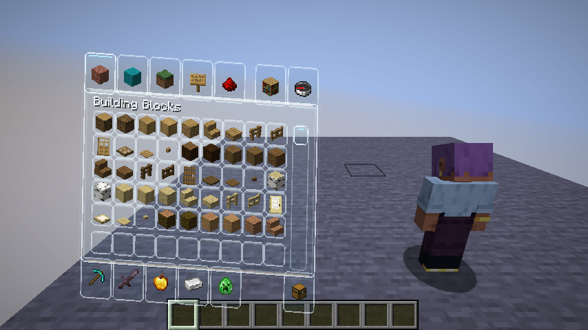
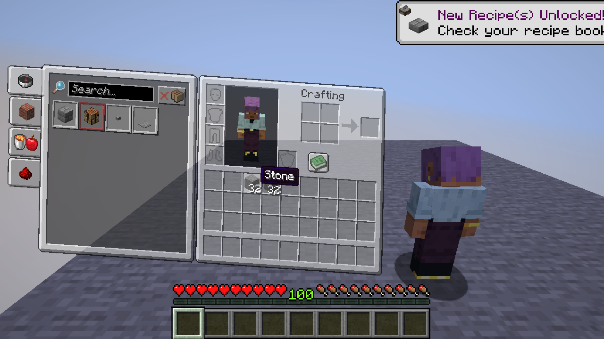

# Hoverglass

**26.x · 0.4.1:** The HUD hotbar and offhand well now use the inventory's glass material by default, with a clear selection rim. Item icons, counts, durability and attack indicators retain vanilla rendering. Cycle through F8 pages to **Hotbar settings** for a separate toggle and transparency slider (84% by default).

**26.x · 0.4.0:** Press **F8 → Liquid glass UI** to toggle rounded translucent chrome, edge highlights and mouse reflections on standard menu buttons and sliders, including pause, options and mod settings. Disabled by default; changes apply immediately and persist when leaving settings. The pause backdrop keeps vanilla blur with a cool gradient. This setting is independent of the glass inventory preset. It uses lightweight GUI drawing rather than optical refraction; custom third-party widgets may retain their own appearance. Available on the 26.x branch with F8 settings.

**26.1.2 · 0.3.3:** Chests and other containers default to 135% size, fit the window and no longer shrink with world-anchor distance. The player's rendered head smoothly follows the cursor in survival and creative inventories, including an existing third-person perspective. F8 offers container sizing and a head-tracking page with an enable switch and horizontal/vertical limits. Tracking changes only the extracted model pose; player orientation, camera and server state stay untouched.

<p align="center">
  
  
</p>

**English** | [简体中文](README.zh-CN.md)

> Turns the vanilla container UI into a see-through glass panel that slides in as the camera pulls back.

Hoverglass is a **client-side** Fabric mod. It runs entirely on the client and **does not need to be installed on the server**. It does not replace vanilla screen logic — only the way it is presented: slots, recipe book, trading, item movement and networking all stay vanilla.

A single source tree supports **Minecraft 1.20.1 – 26.3**, split into two implementation branches; the build produces one jar per target version.

| Branch | Versions | Capabilities |
| --- | --- | --- |
| Glass Inventory (legacy) | 1.20.1 – 1.21.11 | Turns the player inventory (`InventoryScreen`) into a glass panel: it slides in from the left with overshoot and rebound, the player preview slides in from the right, and a white flash lands with it. |
| Spatial Container (spatial) | 26.1 – 26.3 | Everything above extended to **all container screens**, plus planar spatial projection, block/entity world anchoring, a first-person ↔ third-person camera transition, full inverse mapping of mouse input, and an in-game **F8** settings screen. |

> On 1.20.1 – 1.21.11 only the player inventory is handled. Chests, barrels, crafting tables, furnaces and every other container are covered from 26.1 onwards — which is also where the in-game settings appear.

## Download

Grab the jar that matches your game version from the [**Releases page**](../../releases); the exact file names are listed in the version table below. Do not use `-sources.jar`, and do not mix jars for different Minecraft versions.

[**→ Download the latest release**](../../releases/latest)

## Installation

1. Install **Fabric Loader 0.19.5 or newer** for your version.
2. Install **Fabric API** (minimum version in the table below).
3. Download the jar matching your game version from the [Releases page](../../releases) and drop it into your instance's `mods` folder. (When building locally the output lands in `dist/`, which is not tracked by git.)
4. Make sure your Java version matches the table: 1.20.1 – 1.20.4 need Java 17, 1.20.5 – 1.21.11 need Java 21, and 26.x needs Java 25.

### Version table

| Minecraft | Jar file | Branch | Java | Fabric API ≥ |
| --- | --- | --- | --- | --- |
| 1.20.1 | `hoverglass-mc1.20.1-0.3.0.jar` | Glass Inventory | 17 | 0.92.12+1.20.1 |
| 1.20.2 | `hoverglass-mc1.20.2-0.3.0.jar` | Glass Inventory | 17 | 0.91.6+1.20.2 |
| 1.20.3 | `hoverglass-mc1.20.3-0.3.0.jar` | Glass Inventory | 17 | 0.91.1+1.20.3 |
| 1.20.4 | `hoverglass-mc1.20.4-0.3.0.jar` | Glass Inventory | 17 | 0.97.3+1.20.4 |
| 1.20.5 | `hoverglass-mc1.20.5-0.3.0.jar` | Glass Inventory | 21 | 0.97.8+1.20.5 |
| 1.20.6 | `hoverglass-mc1.20.6-0.3.0.jar` | Glass Inventory | 21 | 0.100.8+1.20.6 |
| 1.21 | `hoverglass-mc1.21-0.3.0.jar` | Glass Inventory | 21 | 0.102.0+1.21 |
| 1.21.1 | `hoverglass-mc1.21.1-0.3.0.jar` | Glass Inventory | 21 | 0.116.17+1.21.1 |
| 1.21.2 | `hoverglass-mc1.21.2-0.3.0.jar` | Glass Inventory | 21 | 0.106.1+1.21.2 |
| 1.21.3 | `hoverglass-mc1.21.3-0.3.0.jar` | Glass Inventory | 21 | 0.114.1+1.21.3 |
| 1.21.4 | `hoverglass-mc1.21.4-0.3.0.jar` | Glass Inventory | 21 | 0.119.4+1.21.4 |
| 1.21.5 | `hoverglass-mc1.21.5-0.3.0.jar` | Glass Inventory | 21 | 0.128.2+1.21.5 |
| 1.21.6 | `hoverglass-mc1.21.6-0.3.0.jar` | Glass Inventory | 21 | 0.128.2+1.21.6 |
| 1.21.7 | `hoverglass-mc1.21.7-0.3.0.jar` | Glass Inventory | 21 | 0.129.0+1.21.7 |
| 1.21.8 | `hoverglass-mc1.21.8-0.3.0.jar` | Glass Inventory | 21 | 0.136.1+1.21.8 |
| 1.21.9 | `hoverglass-mc1.21.9-0.3.0.jar` | Glass Inventory | 21 | 0.134.1+1.21.9 |
| 1.21.10 | `hoverglass-mc1.21.10-0.3.0.jar` | Glass Inventory | 21 | 0.138.4+1.21.10 |
| 1.21.11 | `hoverglass-mc1.21.11-0.3.0.jar` | Glass Inventory | 21 | 0.141.6+1.21.11 |
| 26.1 | `hoverglass-mc26.1-0.3.0.jar` | Spatial Container | 25 | 0.145.1+26.1 |
| 26.1.1 | `hoverglass-mc26.1.1-0.3.0.jar` | Spatial Container | 25 | 0.145.4+26.1.1 |
| 26.1.2 | `hoverglass-mc26.1.2-0.3.3.jar` | Spatial Container | 25 | 0.155.3+26.1.2 |
| 26.2 | `hoverglass-mc26.2-0.3.0.jar` | Spatial Container | 25 | 0.159.0+26.2 |
| 26.3 | `hoverglass-mc26.3-0.3.0.jar` | Spatial Container | 25 | 0.163.0+26.3 |

## Glass Inventory branch (1.20.1 – 1.21.11)

- Opening the inventory slides the panel in from the left with ~10% overshoot and rebound, the player preview slides in from the right, and a white flash lands with it.
- The glass panel is drawn from scratch: translucent background, edge outline and per-slot borders, all driven by configuration.
- The player preview can be disabled (`playerPreview`); its position and height are controlled by ratio parameters.
- There is no in-game settings screen. Everything is tuned by hand in `config/transparent_inventory.json` and applies after a restart or after reopening the inventory.
- Animation length is controlled by `openingAnimationDurationMs`, currently 480 ms by default in source.

## Spatial Container branch (26.1 – 26.3)

### First-person inventory entrance

Pressing **E** in first person smoothly pulls the camera back and to the left so the real player model appears on the right of the frame; the inventory slides in from the left, overshoots slightly, rebounds, and settles at a default **4°** tilt. On close the panel exits to the left and the camera returns to its original view. The player's actual position and orientation are never modified.

The tilted slots, dragged items, recipe book and player preview all share the same transform, and mouse coordinates are converted through its full inverse matrix. Camera collision is checked behind and beside the player. If you are already in third person, the regular container layout is kept.

### Transparency

Press **F8** to open settings. While a container is open the settings appear as an overlay, and the container is not closed.

- **Global screen opacity** — shared by every screen without its own override, 0–100%. 0% means fully opaque, 100% means a fully transparent background.
- **Current screen opacity** — saved per screen type only. Chests and anvils can use different opacities, for example, while chests of the same type share the setting.
- **Follow global for this screen** — removes that type's individual opacity.
- **World dim strength** — controls how much the world darkens, independently of panel opacity.
- **Spatial and camera settings** — panel scale, camera distance, camera transition duration, and whether the camera and world anchoring are enabled.

Items, counts, durability bars, text, tooltips and slot hover highlights stay readable. The opacity of vanilla panel textures and skin elements does change. **Esc / F8 / Done** saves and returns to the original screen.

The settings screen supports Chinese and English. F8 is a fixed key; Mod Menu and Cloth Config are not required.

## Configuration

Location: `config/transparent_inventory.json` in your game instance, or `run/config/transparent_inventory.json` for the development client.

The in-game slider speaks in "transparency" while the JSON speaks in "opacity": `panelOpacity: 0.65` corresponds to 35% transparency on the slider. A missing file generates defaults, missing fields fall back to defaults, and out-of-range values are clamped to safe limits. A corrupted JSON keeps the original file at startup and uses defaults in memory; saving writes a temporary file first and then replaces the original.

Common fields, with an example:

```json
{
  "enabled": true,
  "playerPreview": true,
  "closeAnimation": true,
  "panelOpacity": 0.18,
  "worldDimOpacity": 0.0,
  "screenOpacities": {
    "net.minecraft.client.gui.screens.inventory.ContainerScreen": 0.45,
    "net.minecraft.client.gui.screens.inventory.AnvilScreen": 0.8
  },
  "excludedScreens": [],
  "additionalScreens": [],
  "openingAnimationDurationMs": 480,

  "defaultSpatialHandledScreens": true,
  "worldAnchoringEnabled": true,
  "fallbackToScreenSpace": true,
  "cameraEnabled": true,
  "thirdPersonOnOpen": true,
  "cinematicInventory": true,
  "glassInventory": true,
  "inventoryCameraSide": 0.72,
  "inventoryTiltDegrees": 4.0,
  "cameraDistance": 3.0,
  "cameraYawOffset": 0.0,
  "cameraPitchOffset": 0.0,
  "cameraTransitionDurationMs": 420,
  "guiScale": 1.0,
  "containerScale": 1.35,
  "playerLookAtInventory": true,
  "guiDistance": 1.5,
  "guiVerticalOffset": 0.3
}
```

- `panelOpacity` (0–1): panel background opacity, 0 = fully transparent, 1 = opaque; shared by screens without their own override.
- `screenOpacities`: overrides `panelOpacity` by the screen's fully qualified class name.
- `excludedScreens`: uses fully qualified class names and can also exclude a parent class with all of its subclasses. `additionalScreens` explicitly opts non-container screens in; chat, pause and the main menu are never handled by default.
- `worldDimOpacity` (0–1): how strongly the world background darkens.
- `playerPreview` / `playerSlideRatio` / `playerCenterXRatio` / `playerCenterYRatio` / `playerHeightRatio`: player preview toggle, slide distance and position (Glass Inventory branch).
- `inventoryTiltDegrees` (−12–12): the resting tilt of the inventory.
- `cameraEnabled` / `cameraDistance` / `cameraTransitionDurationMs`: camera toggle, distance and transition duration.
- `openingAnimationDurationMs` / `closeAnimation`: open/close animation length and the close animation toggle.
- The file also keeps several tuning fields for slot border opacities, slide physics (`slideSpeed` / `slideBrake` / `bounce`) and visual ratios; all are clamped to safe ranges and can be edited as needed.

Unknown modded containers use a generic profile by default; when there is no reliable anchor the panel falls back to screen-relative placement. Chests and barrels with different slot counts can share the same vanilla `Screen` class, so their per-screen opacity is shared.

## Building from source

```powershell
.\gradlew.bat '-Pmc=1.21.11' collectRelease   # build one version into dist/
.\gradlew.bat '-Pmc=1.21.11' build            # compile + regression for one version
```

`-Pmc=<version>` selects the target Minecraft version (see [`gradle/minecraft-targets.json`](gradle/minecraft-targets.json)); one target is built per invocation. `collectRelease` copies the result into `dist/` at the repository root (already ignored by `.gitignore`, so it never enters version control) under the name `hoverglass-mc<version>-<mod version>.jar`.

The build uses Loom **1.17.20**. 26.x is no longer obfuscated and uses `net.fabricmc.fabric-loom` with no mappings; 1.20.1 – 1.21.11 use `fabric-loom` with official Mojang mappings. Version numbers are maintained in [`gradle.properties`](gradle.properties).

On the Spatial Container branch, `build` also runs a pure-Java regression suite (configuration, input inverse mapping, animation math); client UI verification notes are in the [testing notes](docs/TESTING.md).

## Architecture

`SpatialScreenRegistry` picks a profile; `SpatialScreenManager` owns the session, animation and anchors; `SpatialGuiRenderer` wraps the vanilla extraction pass; `SpatialInputMapper` inverse-maps input with the same transform; `SpatialCameraController` manages the camera and its restoration. Opacity is applied where vanilla submits immutable render state, so item and menu contents are never altered. The Glass Inventory branch instead draws the panel directly from an `InventoryScreen` mixin and reuses the same timeline animation controller.

See the [architecture document](docs/ARCHITECTURE.md).

## Known limitations

- The Spatial Container branch uses planar projection; the tilt is achieved with 2D rotation, shear and horizontal compression. There is no world depth occlusion, true perspective trapezoid or curved GUI.
- The Glass Inventory branch covers the player inventory only, and has no in-game settings screen.
- Third-party screens that use a custom render pipeline, unusual picture-in-picture state, or read raw mouse coordinates need an adapter or an exclusion entry. JEI/REI/EMI, controllers and VR have not been verified.
- Every collected jar requires Fabric API (including the Glass Inventory branch, which also declares that dependency for 1.20.1 – 1.21.11).

## License

Released under the **MIT License**, see [LICENSE](LICENSE).

## Credits

Reference research before implementation: [Spatial GUI](https://github.com/tastytrash/Spatial-GUI), [Fabric 26.2 development notes](https://fabricmc.net/2026/06/15/262.html), [Fabric client gametest](https://docs.fabricmc.net/develop/automatic-testing).

Hoverglass is an independent implementation. It **contains and copies none of Spatial GUI's source code**; the two only overlap in the conceptual direction of "make container screens translucent / spatial".
