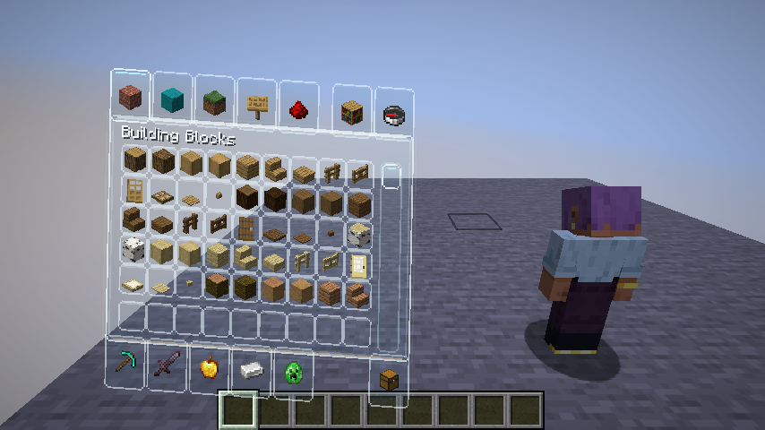
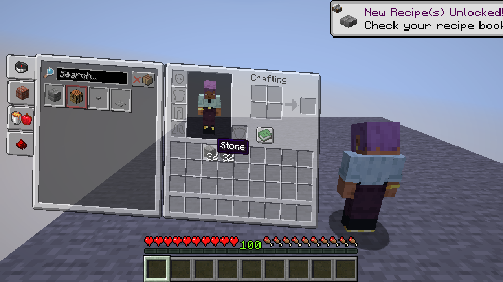

# Hoverglass

<p align="center">
  
  
</p>

[English](README.md) | **简体中文**

> 把原版容器界面变成可透视的玻璃面板，并让它在镜头下拉时从侧面滑入。

**26.x · 0.54.0 总开关**：界面支持设置页现在开放 **Hoverglass 效果**，也就是此前只能改配置文件的总开关。关闭后，玻璃面板、快捷栏玻璃、菜单玻璃主题与新增人物动作都会停止，但不会清除任何设置；设置快捷键仍然有效，随时可以重新打开。

**26.x · 0.53.0 兼容性页提示更准确**：打开兼容性页时，底部提示不再声称按 Delete 可以重置本页，禁用的 **↺** 按钮也会说明原因：该页保存着手写的排除项与逐界面规则，需要在配置文件中重置。其他页面仍显示完整提示和可用的重置按钮。

**26.x · 0.52.0 恢复操作需要确认**：**恢复上一次的设置** 与 **恢复最新快照** 现在同样需要点击两次。第一次点击会把标签改成 **再次点击以确认**，第二次才真正替换配置。两者共用与全部重置相同的确认机制，任何页面重建都会丢弃未完成的确认——翻页或按下其他操作按钮后，恢复不会在之后意外触发。没有备份或快照时仍会明确提示，并回到未确认状态。

**26.x · 0.51.0 全部重置需要确认**：透明度页的 **恢复所有默认设置** 现在需要点击两次。第一次会进入确认状态并把标签改为 **再次点击以全部重置**，第二次才真正恢复所有页面与容器的独立设置。翻页、改变窗口尺寸或按下任何其他操作按钮都会解除确认状态，不会残留；如果真的误操作，仍可用轮换快照找回之前的配置。

**26.x · 0.50.0 完整时长范围**：**镜头过渡时间** 与 **界面开关时间** 滑条现在覆盖配置本来就允许的完整 0–2000 毫秒范围。此前滑条只到 1000 毫秒，手改成更大的值时滑块会贴在最右端，一旦拖动就会跳回；现在可以直接在界面里设置更缓慢的过渡，读数也随新范围显示。

**26.x · 0.49.0 镜头回正**：镜头角度设置页新增 **镜头回正**，一键把两个角度偏角归零，同时保持镜头距离、侧移取景、面板倾斜与过渡时长不变——适合试过角度后只想回正、而不想整套取景回到预设的情况。两个偏角都为零时按钮变为灰色，任一滑条移动后立即重新可用；本页的 Delete 仍会恢复全部镜头数值。

**26.x · 0.48.0 触控板翻页**：设置页现在可以用触控板或高分辨率滚轮翻页。过去每次滚动事件本身必须达到半格，只发送许多小增量的设备永远无法翻页；现在界面会累计滚动量，凑够半格才翻一页，而普通滚轮一格仍然只翻一次。反向抖动会相互抵消而不是累加，快速滑动最多只翻一页，以其他方式翻页时残留的累计量会被清空。

**26.x · 0.47.0 快捷栏填充匹配面板**：快捷栏设置页新增 **匹配面板透明度**，与 **匹配物品栏边框** 成对。它一键把玻璃面板当前的填充透明度复制到快捷栏的独立数值上，让快捷栏与面板看起来属于同一块表面，不必来回拖动两个滑条。与边框匹配一样，这只是一次性复制：面板自身的值不变，快捷栏边框保持不变，之后两个滑条仍可各自调整。

**26.x · 0.46.0 入场减速滑条**：面板手感设置页新增 **入场减速**，即面板滑入过程中施加的减速度——此前只能手改配置中的 `slideBrake`。数值越高，面板在初始推力后越早减速停下；数值越低，则会先滑行一段再交给稳定弹簧收尾。读数以像素/秒²显示，本页的 Delete 重置会恢复默认的 3450，其余手感滑条顺次下移一行以腾出位置。

**26.x · 0.45.0 滑条显示真实数值**：面板手感与预览布局页不再显示滑条的原始位置。入场与退场速度改为像素/秒，回弹显示为百分比，停稳弹簧与阻尼显示原始强度，预览摆放显示为屏幕百分比，配方书偏移显示为像素——与各 tooltip 此前的说明一致。越界值仍会夹紧，非法值仍安全回退，其他滑条的显示保持不变；格式化逻辑集中在一个纯 Java 辅助类中，测试逐键检查。

**26.x · 0.44.0 本页重置按钮**：翻页箭头旁新增 **↺** 按钮，可把当前页恢复为出厂值，不必先知道 Delete 快捷键。它调用与按键相同的 `PageDefaults` 映射；在会丢弃手写规则的兼容性页上按钮为灰色禁用状态，底部提示仍为键盘用户保留 Del 说明。

**26.x · 0.43.0 镜头取景预设**：镜头角度设置页新增 **轻量**、**均衡** 与 **电影感** 三个按钮，一键设定整套取景——镜头拉远距离、左右偏移、面板倾斜、两个角度偏角与过渡时长一起变化，稳定后的画面与镜头运镜保持匹配。**均衡** 就是出厂配置，也可当作一键恢复；与当前取景一致的按钮会禁用，本页的 Delete 现在会恢复全部六个数值，而不只是两个角度。

**26.x · 0.42.0 快捷栏边框匹配物品栏**：快捷栏设置页新增 **匹配物品栏边框**，一键把玻璃面板当前的边框强度复制到快捷栏的独立数值上。这是一次性复制而不是实时联动，之后两个滑条仍可各自调整；再次点击按钮之前，快捷栏一直保持自己的边框。

**26.x · 0.41.0 恢复按钮显示快照数量**：**恢复最新快照** 现在会在标签后显示当前保留的快照数量，历史为空时按钮变灰并用 tooltip 说明原因。每次重建页面都会刷新计数，恢复或保存后立即反映；读取失败按 0 处理，不做猜测。

**26.x · 0.40.0 移除已失效的配置键**：`lookDistance`、`maxBodyYaw`、`bodyYawRatio` 与 `playerSlideSmoothing` 四个不再驱动任何行为的数值已从保存文件中移除，配置不再罗列那些悄悄无效的选项。仍写着这些键的旧文件可以照常载入：未知键会被忽略，其余数值正常读取，下一次保存会顺带清掉这些残留项。

**26.x · 0.39.0 页面记忆跨重启保留**：0.32.0 的页面记忆现在会以 `settingsPage` 写入配置，关闭游戏再打开后仍会回到上次的设置页，而不是从透明度页重新开始。翻页仍会立即更新本次会话，手改成越界值时会被夹紧回第一页，离开设置界面时照常保存。

**26.x · 0.38.0 清空已添加的界面**：界面支持设置页新增 **清空已添加的界面** 按钮，一键移除此前通过该页加入的所有界面——精确条目和通配规则都会被清掉。手改 `additionalScreens` 加入的内容同样会被清除，与兼容性页现有的清空按钮行为一致；内置容器的处理不受影响。按钮位于设置快捷键下方，点击后立即刷新页面。

**26.x · 0.37.0 恢复最新快照**：0.31.0 加入的轮换历史现在不必打开文件管理器也能使用。兼容性页的 **恢复最新快照** 会载入 `transparent_inventory-backups/` 中时间戳最新的一份并保存，适用于连续几次错误保存已经把普通 `.bak` 挤掉的情况。还没有快照时按钮会明确提示而不是静默失败，目录中的无关文件会被忽略；复制与粘贴改为并排一行以腾出空间。

**26.x · 0.36.0 面板手感设置页**：新增第十五页，直接开放滑入动画本身。**入场滑入速度**、**退场滑出速度**、**回弹幅度**、**稳定弹簧强度** 与 **稳定阻尼** 决定玻璃面板如何滑入、回弹和停稳——既可以是干脆利落的快速停下，也可以是缓慢柔和的漂移。这些就是动画器原本使用的数值，滑条改变的是真实面板；按 Delete 可恢复默认手感。无论滑条如何设置，减少动态效果仍会让所有动画瞬间完成。

**26.x · 0.35.0 预览布局设置页**：新增第十四页，开放过去只能手改配置的五个摆放参数。**预览人物高度**、**预览人物水平位置**、**预览人物垂直位置** 决定第三人称人物在屏幕上的位置，**面板水平位置** 移动玻璃面板，**配方书偏移** 在打开配方书时平移面板。某些分辨率和界面缩放下人物会与面板重叠，现在用滑条即可修正，不必改 JSON。每个值仍受加载时的范围限制，在本页按 Delete 会同时恢复五项，人物依然只是姿势预览。

**26.x · 0.34.0 滚轮翻页**：现在可以用鼠标滚轮切换 F8 的各个页面——向上滚回上一页，向下滚到下一页，首尾同样循环。翻到最后一页不再需要点九次或伸手按键盘。触控板的亚格抖动和非法滚动量会被忽略，避免页面意外翻转，Page Up / Page Down 仍照常可用。

**26.x · 0.33.0 遮罩随面板淡入淡出**：玻璃面板背后的世界遮罩现在跟随入场动画，而不是第一帧就直接变成最深。打开时随着面板滑入逐渐压暗世界，关闭时随面板一起淡出，两段过渡都不再突兀。**世界遮罩**强度仍决定稳定后的不透明度，减少动态效果开关和零时长设置依旧瞬间完成，不使用空间面板的界面保持原版遮罩行为。

**26.x · 0.32.0 记住上次设置页**：F8 设置界面现在会回到本次会话中最后停留的页面，而不是每次都从透明度页开始，反复调整同一页只需按一次键。**End** 直接跳到最后一页，与 **Home** 跳回第一页对称；两者都使用同一套带夹紧的页面记忆，每次重建控件后页码位置保持不变。

**26.x · 0.31.0 配置快照轮换**：保存时的保护不再只有一份 `.bak`。每次保存还会把当前文件按时间戳复制到 `config/transparent_inventory-backups/`，并只保留最新的 5 份，连续多次错误保存后仍可手动回溯。原有的同级 `.bak`、兼容性页「恢复上一次的设置」以及「复制失败不阻止保存」的规则保持不变；由于加载器共享，两个分支都会获得这份历史。

**26.x · 0.30.0 待机摇摆**：站立的角色不再在动作之间僵硬定格。人物动作设置页新增 **待机摇摆** 开关，加入呼吸层——胸口起伏、双臂微微外张、重心缓慢左右偏移——幅度不超过 0.03 弧度，并随 **人物动作强度** 缩放。走路循环或落地姿态接管时会立即停止，双腿完全交给原版；旁边的开关已改名为 **空中姿态** 以腾出空间。

**26.x · 0.29.0 可改的设置快捷键**：界面支持设置页新增 **设置快捷键**，可在 F6–F10 之间循环更改打开设置界面的按键（默认仍为 F8）。与其他模组按键冲突时不再只能迁就 F8。配置中的 `settingsKey` 在载入时会校验，手工改成普通游戏按键或不在列表内的名称都会回退到 F8；底部提示也不再写死具体按键。

**26.x · 0.28.0 界面支持设置页**：新增第十三页，把过去只能手改配置的三个界面选择项开放出来。**已识别的容器使用玻璃**（默认开启）决定内置容器界面是否使用空间化玻璃面板；**投影失败时保留玻璃** 决定镜头无法到达的界面是回退到玻璃还是原版。第三个按钮可把打开设置时所处的界面加入或移出玻璃处理，模组菜单不必再手改 `additionalScreens`；它只增删精确条目，通配规则只做提示、绝不改写，当前已打开容器时按钮会说明为何不可用。

**26.x · 0.27.0 关闭动画开关**：入场设置页新增 **关闭动画** 开关，也就是配置文件中原本就有的 `closeAnimation`。关闭后，关闭容器时玻璃面板会在同一帧直接消失，而不是滑出画面，适合快速切换容器或偏好硬切的玩家。它与 **第一人称侧移入场** 并排占用第一行；本页的 Delete 重置会把它恢复为开启。

**26.x · 0.26.0 单页重置**：在设置页按 **Delete** 会把当前页的每个控件恢复为出厂值，其他页面保持不变，不必再为了一个调错的滑条而使用透明度页的「全部重置」。页面与默认值的对应关系集中在一个纯 Java 辅助类里，测试逐页检查；兼容性页刻意不参与重置，因为它保存着手写的排除项与独立透明度规则。底部提示也会显示该按键。

**26.x · 0.25.0 落地姿态**：第三人称角色真正落地时不再直接切回走路循环，而是吸收这次下落。动作层会在角色腾空时记录下降速度，落地瞬间起用一个短促的下蹲——双膝前收、上身微折、双臂外展保持平衡——并在 6 tick 内平滑衰减，幅度随实际冲击速度与 **人物动作强度** 缩放。小幅台阶仍保持原版；**落地反馈** 开关（此前只影响镜头）会同时关闭镜头落地反馈与姿态；攻击、攀爬与空中姿态仍然优先。

**26.x · 0.24.0 材质预设**：玻璃材质设置页新增三个预设按钮——**清透**、**磨砂**、**鲜明**，一键套用全部五个透明度。每套数值都落在设定范围内且保持递进关系，从清透到鲜明，填充、描边与高亮一起变强；其中 **磨砂** 与默认配置完全一致，可当作一键恢复出厂观感。当前生效的预设按钮会置灰，页面始终能看出正在使用哪种材质；任意拖动一个滑条后三个按钮都会重新可用，方便继续微调。

**26.x · 0.23.0 玻璃材质设置页**：新增第十二页，把过去只能手改配置的透明度开放出来：**槽位填充**、**面板描边**、**槽位描边**、**悬停高亮** 与 **选中高亮**。这些就是渲染器实际使用的一组数值，调整会直接改变玻璃外观而不是预览；载入时仍统一夹紧到 0–100%。快捷栏描边继续使用 0.17.0 的独立设置。

**26.x · 0.22.0 键盘翻页**：**Page Up** 与 **Page Down** 可循环切换十一页设置，**Home** 直接回到透明度页，不必再点击箭头翻过整圈才能到达较远的页面。按键与箭头按钮使用同一套首尾循环逻辑，底部提示也会显示这些按键与 F8 / Esc 保存快捷键。

**26.x · 0.21.0 镜头角度**：设置新增第十一页 **镜头角度设置**，把配置中原本就存在、但没有界面的两个取值开放出来：**镜头左右偏角**（−60° 至 +60°）与 **镜头上下偏角**（−45° 至 +45°）。它们会左右、上下旋转停留构图，并像其他镜头参数一样随过渡一起混合。兼容性页仍保持在第 10 页（索引 9），既有页面与翻页顺序不变。两个值在载入时都会夹紧，手工修改的配置也无法超出设定范围。

**26.x · 0.20.0 页面标题**：设置页标题行现在会显示当前页面名称，例如「流畅动画设置」「兼容性设置」。此前的标题行始终描述当前容器的透明度来源，即使正在看镜头或动效页；现在该描述只出现在透明度页，其他页显示自己的名称。另外新增语言文件回归检查：`en_us` 与 `zh_cn` 的键集合必须完全一致，且每个设置页标题都必须有翻译，否则构建失败，缺翻译的原始键不会再随版本发布。

**26.x · 0.19.0 攀爬姿态**：**跳跃、下落与攀爬姿态** 开关现在也覆盖梯子和藤蔓。角色在可攀爬方块上垂直移动时，会以对角交替的方式伸手——右臂配合左腿，然后反向——而不是沿用原版仍在播放的走路循环。伸手幅度跟随实际攀爬速度与 **人物动作强度**，下降时方向相反；静止悬挂不添加任何姿态。垂直速度由服务器同步，因此附近玩家同样生效，攻击动作仍然优先。

**26.x · 0.18.0 快速重开窗口**：入场设置页现在提供 **快速重开窗口** 滑条（0–1500 ms，默认 400 ms），也就是 0.10.0 起控制重开捷径的那个值。拖到 0 会让每次打开都完整播放入场动画；调大后，连续切换容器时捷径保持更久。滑条与配置中的 `reopenSnapWindowMs` 共用同一套夹紧映射。

**26.x · 0.17.0 快捷栏描边**：快捷栏设置页新增 **快捷栏描边强度** 滑条，由新的 `hotbarBorderOpacity` 控制（默认 72%），与背包面板描边相互独立。调暗 HUD 底板时不会再连带削弱背包描边，也可以在面板保持低调的同时保留清晰的快捷栏边框。

**26.x · 0.16.0 头部跟随速度**：头部跟随设置页新增 **头部跟随速度** 滑条（默认约 26%，范围 0–100%）。它直接驱动原有的指数平滑，因此人物头部既可以懒散地跟随鼠标，也可以几乎立刻追上；更新在任何帧率下都保持帧率无关，且更高的速度不会越过目标角度。

**26.x · 0.15.0 配置备份**：每次保存时，会先把上一份 `config/transparent_inventory.json` 复制为 `transparent_inventory.json.bak`，再写入新文件。兼容性页新增 **恢复上一次的设置**，读取该备份并保存；由于恢复本身也是一次保存，再次点击会换回刚才被替换的版本（两者互换）。如果还没有任何一次保存，按钮会提示暂无可恢复内容，而不是静默失败。只保留一份上一版本，复制失败也不会阻止本次保存。

**26.x · 0.14.0 跳跃与下落姿态**：第三人称角色不再像是在空中原地跑步。上升时双膝对称前收、手臂略微抬起；下落时双臂向两侧展开保持平衡、双腿后摆。该姿态只在角色离地且不在水中、岩浆里或梯子上时生效，真实攻击动作仍然优先。垂直速度由服务器同步，因此附近玩家也会呈现相同姿态。姿态幅度跟随 **人物动作强度**，可在「人物动作设置」页用独立开关 **跳跃与下落姿态**（默认开启）关闭；总开关或 **减少动态效果** 仍会停用它。

**26.x · 0.13.0 设置剪贴板**：兼容性设置页现在可以把整份配置以格式化 JSON 复制到剪贴板，再粘贴回来，方便在不同实例之间迁移或分享给朋友。粘贴前会先校验：不是 JSON 对象的文本（以及超过 256 KB 的内容）会被拒绝并给出聊天提示，不会覆盖现有配置。通过校验的值仍会经过启动时同一套 `sanitize()`，越界数值会被夹紧、脏的界面规则会被清理，而不是原样写入。粘贴成功后会立即保存 `transparent_inventory.json` 并刷新当前设置页。

**26.x · 0.12.0 翻页导航**：F8 设置页已增加到十页，因此在「下一页」旁新增 **上一页** 按钮；两者首尾循环，悬停时会提示将前往的页面名称。底部提示行改为先显示 **第 3 / 10 页**，再显示实时预览说明，随时知道当前在循环中的位置。页面顺序与标题集中在纯 Java 的 `SettingsPages` 中，下一页/上一页按钮文案与翻页逻辑由同一份数据生成，不会互相对不上。

**26.x · 0.11.0 兼容性设置页**：F8 设置新增第十页 **兼容性设置**。**排除当前容器** 会为当前打开的界面关闭玻璃面板，同一按钮随即变为 **重新启用当前容器**；如果该界面是被通配规则排除而非拥有自己的条目，按钮显示 **已被界面规则排除**，并且不会改动规则，避免误删一条覆盖多个界面的规则。下方两个快捷键可 **清除全部排除项** 与 **重置全部独立透明度**（含通配条目），此后回落到全局透明度。排除项仍保存在原有的 `excludedScreens` 列表中，手工编辑的规则与按钮状态保持一致。

**26.x · 0.10.1 界面规则状态**：F8 透明度页的标题现在区分三种情况：当前界面的独立值、来自通配规则的继承值（「来自界面通配规则」）以及全局值。**当前界面跟随全局** 按钮只在存在独立条目时可用，清除后自动变灰，不会再把通配规则误当成全局默认，也不会点了却毫无反应。

**26.x · 0.10.0 快速重新打开**：关闭容器后 400 ms 内再次打开任意容器，会跳过面板入场与镜头过渡，直接停在稳定视角，连按 E 开关不再每次都重播整套滑入。首次打开与间隔较久的重新打开仍正常播放动画。窗口可通过 `reopenSnapWindowMs` 调整（0 关闭该捷径，最大 1500 ms），两个分支均生效；**减少动态效果**仍然让每次打开都瞬切。

**26.x · 0.9.0 新增容器镜头开关**：F8 的镜头设置页新增 **容器镜头** 开关（默认开启）。关闭后，箱子、熔炉、村民交易等世界容器保持第一人称视角，但玻璃面板、独立透明度与世界锚点照常生效；玩家物品栏仍使用自己的入场镜头，总开关 **空间镜头** 依旧可以同时停用两者。该选项以 `containerCameraEnabled` 保存在配置文件中，与其他镜头字段并列。

**26.x · 0.8.1 损坏配置恢复**：当 `config/transparent_inventory.json` 无法解析时，现在会先把它改名保存为 `transparent_inventory.json.corrupt-<UTC 时间戳>`，再使用默认值。此前内存中的默认值会在下一次保存时覆盖无法读取的文件，手工修改的内容因此丢失。备份名使用 Windows 安全的时间戳，不会互相覆盖，并限制长度；如果改名本身失败，原文件保持不动，仅本次会话使用默认值。

**26.x · 0.8.0 减少动态覆盖界面**：已有的 **减少动态效果** 开关现在也作用于容器界面。开启后，玻璃面板直接以停留姿态出现和消失，没有滑入、回弹、落地闪光或淡入淡出，镜头也直接切换到容器构图，不再平移。关闭开关时 F8 中的时长设置照常生效。时长为 0 的镜头过渡现在在同一帧到达目标视角，而不是晚一帧，因此把镜头过渡滑条拖到 0 也会干净地瞬切。该设置与其他配置一起保存，并在两个分支上生效。

**26.x · 0.7.0 新增界面规则**：`screenOpacities`、`excludedScreens` 与 `additionalScreens` 支持 `*`（任意长度字符）与 `?`（单个字符）通配符，一条规则即可覆盖一类界面，例如 `"net.minecraft.client.gui.screens.inventory.*"` 或 `"*MerchantScreen"`。精确类名始终优先于通配规则，多个通配规则中字面字符最多的那条生效，因此界面内的独立透明度滑块行为不变。载入与保存时会自动去除首尾空格、去重并限制规则长度。

**26.x · 0.6.1 新增疾跑跨步**：疾跑时在原版步态上叠加更宽的交替跨步、反向摆臂、躯干前倾和头部反向补偿。所有可见的疾跑玩家都会生效，普通走路保持原样；可在 F8「人物动作设置」中开关。

**26.x · 0.6.0 新增人物动作**：所有可见玩家的剑、斧、长矛与工具挥动都会带动全身，工作台打开时本地玩家会做出双手伏案的合成动作。姿态叠加在原版动画之后，行走、潜行、骑乘、使用物品和原版手臂挥动均保持原样；独立的盔甲模型也会同步姿态，避免盔甲与身体脱节。工作台动作只作用于本地玩家，因为纯客户端模组无法读取其他玩家打开的菜单。按 **F8** 翻页至 **人物动作设置**，可分别开关总功能、攻击动作和合成动作，并调整默认 80% 的动作强度。详见 [动效集成审计](docs/MOTION-AUDIT.md)。

**26.x · 0.5.0 新增流畅动效 MVP**：手持物品按时间平滑降下、替换、抬起与轻微回弹；增强剑/工具挥动；增加轻微疾跑、起跳、落地及已确认命中的视图反馈。方块破坏追加少量材质碎片，放置采用约 200 ms 的材质粒子脉冲代理，不缩放真实区块。全部只改变客户端显示。

按 **F8** 翻页到 **流畅动画设置 → 视角动效设置 → 世界反馈设置 → 人物动作设置**，可分别开关和调整强度。新增动效默认开启，手部强度 65%、视角强度 50%；**减少动态效果** 会停用新增动效。关闭原版视角摇晃或把屏幕效果强度设为 0，会停用新增相机运动；命中反馈也尊重原版受伤倾斜强度。打开菜单、第三人称、旁观者、飞行或乘坐时不追加第一人称视角动效；地图、饮用和拉弓继续使用原版手部流程。原有玻璃背包、液态玻璃菜单和透明快捷栏保持独立设置。

架构审计、注入点、文件清单和验证范围见 [动效集成审计](docs/MOTION-AUDIT.md)。新运行时仅集成到 26.x 分支；legacy 保留原功能。

**26.x · 0.4.1 新增**：底部九格快捷栏和副手槽默认采用与背包一致的透明玻璃底板及槽位描边，选中格保持明亮边框。物品、数量、耐久和攻击指示保持原版。F8 翻页至 **快捷栏设置** 可单独关闭或调整透明度，默认透明度 84%，不跟随容器入场动画或透明度覆盖。

**26.x · 0.4.0 新增**：按 **F8 → 液态玻璃 UI** 随时开关菜单风格。默认关闭；开启后，暂停菜单、选项与 Mod 设置中的常规按钮和滑块使用圆角半透明玻璃、边缘高光与鼠标反光，暂停界面使用冷色背景渐变并保留原版模糊。即时生效，F8 / Esc / 完成保存，下次启动保留选择。此开关独立于「透明玻璃背包」和背包预设；不改变按钮布局或原版输入。采用轻量 GUI 绘制模拟玻璃质感，不提供真实光学折射；第三方自绘控件不保证套用主题。该功能仅在提供 F8 设置的 26.x 分支实现。

**26.1.2 · 0.3.3 更新**：箱子等容器默认放大至 135%，不再随世界锚点距离缩小，并自动适应窗口。生存及创造背包的人物头部会平滑跟随鼠标，原有第三人称也支持。打开 **F8 → 空间与镜头设置** 可调整容器大小；继续切到 **人物头部跟随设置** 可调整开关和左右、上下幅度。头部跟随仅修改显示姿态，不改变实际朝向、镜头或服务器数据。创造模式玻璃界面与原有透明度设置继续保留。

Hoverglass 是一个 Fabric **客户端**模组，纯客户端生效，**服务器不需要安装**。它不替换原版界面逻辑，只改变呈现方式：槽位、配方书、交易、物品搬运和网络协议全部保持原版。

同一套源码支持 **Minecraft 1.20.1 – 26.3**，按版本分成两条实现分支，构建时按目标版本生成各自的 jar。

| 分支 | 覆盖版本 | 能力 |
| --- | --- | --- |
| 玻璃背包（legacy） | 1.20.1 – 1.21.11 | 玩家背包（`InventoryScreen`）玻璃面板化：带过冲与回弹地从左侧滑入，玩家预览从右侧滑入，落位时有一道白光闪光。 |
| 空间容器（spatial） | 26.1 – 26.3 | 在上面基础上扩展到**全部容器界面**，并加入平面空间投影、方块/实体世界锚点、第一人称 ↔ 第三人称镜头过渡、鼠标输入的完整逆变换，以及游戏内 **F8** 设置界面。 |

> 1.20.1 – 1.21.11 只处理玩家背包；从 26.1 起才覆盖箱子、木桶、工作台、熔炉等全部容器，并提供游戏内设置。

## 下载

从 [**Releases 页面**](../../releases) 下载与你游戏版本一致的 jar，文件名见下方版本对照表。不要使用 `-sources.jar`，也不要把不同 MC 版本的 jar 混放。

[**→ 下载最新版本**](../../releases/latest)

## 安装

1. 安装对应版本的 **Fabric Loader 0.19.5 或以上**。
2. 安装对应版本的 **Fabric API**（最低版本见下表）。
3. 从 [Releases 页面](../../releases) 下载与你游戏版本一致的那个 jar，放进实例的 `mods` 文件夹（自行构建时产物在本地 `dist/` 目录，该目录不入版本库）。
4. 确保 Java 版本匹配下表：1.20.1 – 1.20.4 需要 Java 17，1.20.5 – 1.21.11 需要 Java 21，26.x 需要 Java 25。

### 版本对照

| Minecraft | Jar 文件 | 分支 | Java | Fabric API ≥ |
| --- | --- | --- | --- | --- |
| 1.20.1 | `hoverglass-mc1.20.1-0.3.0.jar` | 玻璃背包 | 17 | 0.92.12+1.20.1 |
| 1.20.2 | `hoverglass-mc1.20.2-0.3.0.jar` | 玻璃背包 | 17 | 0.91.6+1.20.2 |
| 1.20.3 | `hoverglass-mc1.20.3-0.3.0.jar` | 玻璃背包 | 17 | 0.91.1+1.20.3 |
| 1.20.4 | `hoverglass-mc1.20.4-0.3.0.jar` | 玻璃背包 | 17 | 0.97.3+1.20.4 |
| 1.20.5 | `hoverglass-mc1.20.5-0.3.0.jar` | 玻璃背包 | 21 | 0.97.8+1.20.5 |
| 1.20.6 | `hoverglass-mc1.20.6-0.3.0.jar` | 玻璃背包 | 21 | 0.100.8+1.20.6 |
| 1.21 | `hoverglass-mc1.21-0.3.0.jar` | 玻璃背包 | 21 | 0.102.0+1.21 |
| 1.21.1 | `hoverglass-mc1.21.1-0.3.0.jar` | 玻璃背包 | 21 | 0.116.17+1.21.1 |
| 1.21.2 | `hoverglass-mc1.21.2-0.3.0.jar` | 玻璃背包 | 21 | 0.106.1+1.21.2 |
| 1.21.3 | `hoverglass-mc1.21.3-0.3.0.jar` | 玻璃背包 | 21 | 0.114.1+1.21.3 |
| 1.21.4 | `hoverglass-mc1.21.4-0.3.0.jar` | 玻璃背包 | 21 | 0.119.4+1.21.4 |
| 1.21.5 | `hoverglass-mc1.21.5-0.3.0.jar` | 玻璃背包 | 21 | 0.128.2+1.21.5 |
| 1.21.6 | `hoverglass-mc1.21.6-0.3.0.jar` | 玻璃背包 | 21 | 0.128.2+1.21.6 |
| 1.21.7 | `hoverglass-mc1.21.7-0.3.0.jar` | 玻璃背包 | 21 | 0.129.0+1.21.7 |
| 1.21.8 | `hoverglass-mc1.21.8-0.3.0.jar` | 玻璃背包 | 21 | 0.136.1+1.21.8 |
| 1.21.9 | `hoverglass-mc1.21.9-0.3.0.jar` | 玻璃背包 | 21 | 0.134.1+1.21.9 |
| 1.21.10 | `hoverglass-mc1.21.10-0.3.0.jar` | 玻璃背包 | 21 | 0.138.4+1.21.10 |
| 1.21.11 | `hoverglass-mc1.21.11-0.3.0.jar` | 玻璃背包 | 21 | 0.141.6+1.21.11 |
| 26.1 | `hoverglass-mc26.1-0.3.0.jar` | 空间容器 | 25 | 0.145.1+26.1 |
| 26.1.1 | `hoverglass-mc26.1.1-0.3.0.jar` | 空间容器 | 25 | 0.145.4+26.1.1 |
| 26.1.2 | `hoverglass-mc26.1.2-0.3.3.jar` | 空间容器 | 25 | 0.155.3+26.1.2 |
| 26.2 | `hoverglass-mc26.2-0.3.0.jar` | 空间容器 | 25 | 0.159.0+26.2 |
| 26.3 | `hoverglass-mc26.3-0.3.0.jar` | 空间容器 | 25 | 0.163.0+26.3 |

## 玻璃背包分支（1.20.1 – 1.21.11）

- 打开背包时，面板从左侧带过冲（约 10%）与回弹地滑入，玩家预览从右侧滑入，落位时有一道白光闪光。
- 玻璃面板自绘：半透明背景、四边描边、全部槽位边框，透明度由配置控制。
- 玩家预览可以关闭（`playerPreview`），位置与高度由比例参数控制。
- 没有游戏内设置界面，所有参数通过 `config/transparent_inventory.json` 手动调整，重启或重新打开背包后生效。
- 动画时长由 `openingAnimationDurationMs` 控制，源码默认 480 ms。

## 空间容器分支（26.1 – 26.3）

### 第一人称背包入场

从第一人称按 **E** 打开背包时，镜头向左后方平滑拉开，让真实人物出现在画面右侧；背包从左侧滑入，轻微越过目标后回弹，最终保留默认 **4°** 的斜面构图。关闭时面板向左退出，镜头回到原视角。玩家的实际位置和朝向不会被修改。

倾斜后的槽位、拖拽物品、配方书和人物预览使用同一变换，鼠标坐标按完整逆矩阵换算。镜头后方和侧方均有墙体碰撞检查。原本已处于第三人称时保留常规容器布局。

### 透明度

按 **F8** 打开设置。容器打开时，设置以覆盖层显示，原容器不会被关闭。

- **全局界面透明度**：所有没有独立配置的界面共用，范围 0–100%。0% 表示完全不透明，100% 表示背景完全透明。
- **当前界面透明度**：只对当前界面类型保存。例如箱子和铁砧可以使用不同透明度，同一类型的箱子共用设置。
- **当前界面跟随全局**：删除该类型的独立透明度。
- **世界背景遮罩强度**：单独控制世界变暗程度；与面板透明度无关。
- **应用参考图玻璃效果**：将生存及创造背包设为 84% 透明度、明亮描边、左滑扫光与右侧人物构图，保留其他容器的独立透明度。更改镜头与入场设置后，关闭并重新打开背包查看完整动画。
- **空间与镜头设置**：调整界面大小、镜头距离、镜头过渡时间，以及是否启用镜头和世界锚点。
- **箱子等容器显示大小**：75–200%，默认 135%；影响箱子、木桶、工作台等，独立于背包构图。长容器按窗口可用空间限制放大。
- **背包入场动画**：可切换玻璃材质、调整人物向右让位幅度、停留倾角和动画时间。
- **人物头部跟随设置**：默认开启。人物头部跟随背包内鼠标平滑左右、上下转动；可分别调整幅度，打开设置期间保持上一视线，关闭背包后恢复原版表现。

物品、数量、耐久条、文字、工具提示和槽位悬停高亮保持可读。玻璃背包的透明度只影响玻璃底和槽位填充，边框及装备提示仍可见；其他容器仍调整原版面板贴图透明度。**Esc / F8 / 完成** 保存并返回原界面。

设置界面支持中文和英文。F8 为固定快捷键；无需 Mod Menu 或 Cloth Config。

## 配置文件

位置：游戏实例的 `config/transparent_inventory.json`，开发客户端对应 `run/config/transparent_inventory.json`。

界面滑块使用“透明度”，JSON 使用“不透明度”：`panelOpacity: 0.65` 对应滑块透明度 35%。文件缺失时生成默认配置，字段缺失使用默认值，非法数值会被夹取到安全范围内。损坏的 JSON 会被改名为 `transparent_inventory.json.corrupt-<UTC 时间戳>` 并使用默认设置，避免下一次保存覆盖不可读文件；若改名失败则保留原文件，仅本次会话使用默认值。保存时先写临时文件，再替换原文件。

常用字段与示例：

```json
{
  "enabled": true,
  "playerPreview": true,
  "closeAnimation": true,
  "panelOpacity": 0.18,
  "worldDimOpacity": 0.0,
  "screenOpacities": {
    "net.minecraft.client.gui.screens.inventory.ContainerScreen": 0.45,
    "net.minecraft.client.gui.screens.inventory.AnvilScreen": 0.8
  },
  "excludedScreens": [],
  "additionalScreens": [],
  "openingAnimationDurationMs": 480,

  "defaultSpatialHandledScreens": true,
  "worldAnchoringEnabled": true,
  "fallbackToScreenSpace": true,
  "cameraEnabled": true,
  "containerCameraEnabled": true,
  "thirdPersonOnOpen": true,
  "cinematicInventory": true,
  "glassInventory": true,
  "inventoryCameraSide": 0.72,
  "inventoryTiltDegrees": 4.0,
  "cameraDistance": 3.0,
  "cameraYawOffset": 0.0,
  "cameraPitchOffset": 0.0,
  "cameraTransitionDurationMs": 420,
  "guiScale": 1.0,
  "containerScale": 1.35,
  "playerLookAtInventory": true,
  "guiDistance": 1.5,
  "guiVerticalOffset": 0.3
}
```

- `panelOpacity`（0–1）：面板背景不透明度，0 = 全透明，1 = 不透明；未单独配置的界面共用它。
- `screenOpacities`：按界面完整类名覆盖 `panelOpacity`。键也可以是通配规则：`*` 匹配任意长度字符（可为空），`?` 匹配单个字符。精确类名优先；否则字面字符最多的匹配规则生效，同等具体度时保留先写入的条目。
- `excludedScreens`：使用完整类名，也能排除某个父类及其所有子类。`additionalScreens` 可显式加入非容器界面；默认不会处理聊天、暂停、主菜单。两个列表都支持与 `screenOpacities` 相同的通配符，例如 `"*MerchantScreen"` 或 `"com.example.mods.*"`。
- `worldDimOpacity`（0–1）：世界背景变暗强度。
- `playerPreview` / `playerSlideRatio` / `playerCenterXRatio` / `playerCenterYRatio` / `playerHeightRatio`：玩家预览的开关、滑入距离与位置（玻璃背包分支）。
- `inventoryTiltDegrees`（−12–12）：背包停留倾角。
- `cameraEnabled` / `containerCameraEnabled` / `cameraDistance` / `cameraTransitionDurationMs`：总镜头开关、容器是否使用镜头（物品栏保留自己的入场构图）、距离与过渡时间。
- `openingAnimationDurationMs` / `closeAnimation`：开关动画时长与关闭动画开关。
- `reopenSnapWindowMs`（0–1500）：距上次关闭该时长内重新打开容器时跳过入场与镜头过渡；0 表示每次播放动画。
- 文件中还保留了若干槽位描边透明度、滑入物理（`slideSpeed` / `slideBrake` / `bounce`）和视觉比例的调参字段，均会被夹取到安全范围，可按需修改。

未知模组容器默认使用通用 profile；没有可靠锚点时回退到屏幕相对位置。不同槽位数的箱子和木桶可能使用同一个原版 Screen 类，因此它们的独立透明度会共用。

## 从源码构建

```powershell
.\gradlew.bat '-Pmc=1.21.11' collectRelease   # 构建单个版本到 dist/
.\gradlew.bat '-Pmc=1.21.11' build            # 单版本编译 + 回归
```

`-Pmc=<版本>` 选择要编译的目标 Minecraft 版本（取值见 [`gradle/minecraft-targets.json`](gradle/minecraft-targets.json)），每次只编译一个目标。产物由 `collectRelease` 统一复制到根目录 `dist/`（已在 `.gitignore` 中忽略，不会进入版本库），文件名形如 `hoverglass-mc<版本>-<mod 版本>.jar`。

构建使用 Loom **1.17.20**。26.x 已不再混淆，使用 `net.fabricmc.fabric-loom` 且不需要映射；1.20.1 – 1.21.11 使用 `fabric-loom` 并套用 Mojang 官方映射。版本号统一在 [`gradle.properties`](gradle.properties) 中维护。

空间容器分支的 `build` 会附带一个纯 Java 回归（配置、输入反算、动画数学）；客户端界面验证记录见 [测试记录](docs/TESTING.md)。

## 架构

`SpatialScreenRegistry` 选择 profile；`SpatialScreenManager` 持有会话、动画和锚点；`SpatialGuiRenderer` 包裹原版提取流程；`SpatialInputMapper` 用同一份变换反算输入；`SpatialCameraController` 管理镜头和恢复。透明度在原版不可变渲染状态提交时处理，不改变物品或菜单内容。玻璃背包分支则通过一个 `InventoryScreen` mixin 直接自绘面板并复用同一套时间轴动画控制器。

详见 [架构文档](docs/ARCHITECTURE.md)。

## 已知限制

- 空间容器分支使用平面投影，倾斜通过二维旋转、剪切和横向压缩实现；没有世界深度遮挡、真实透视梯形或曲面 GUI。
- 玻璃背包分支只覆盖玩家背包，且没有游戏内设置界面。
- 对使用自定义渲染管线、特殊画中画状态或自行读取原始鼠标坐标的第三方界面，需要适配或加入排除列表。尚未验证 JEI/REI/EMI、控制器或 VR。
- 收集到的 jar 全部要求 Fabric API（含玻璃背包分支，当前版本对 1.20.1 – 1.21.11 亦声明该依赖）。

## 许可

本项目以 **MIT License** 发布，见 [LICENSE](LICENSE)。

## 致谢

实现前参考研究：[Spatial GUI](https://github.com/tastytrash/Spatial-GUI)、[Fabric 26.2 开发说明](https://fabricmc.net/2026/06/15/262.html)、[Fabric 客户端游戏测试](https://docs.fabricmc.net/develop/automatic-testing)。

Hoverglass 为独立实现，**不包含、也未复制 Spatial GUI 的任何源代码**；两者仅在“把容器界面透明化 / 空间化”这一概念方向上有交集。
